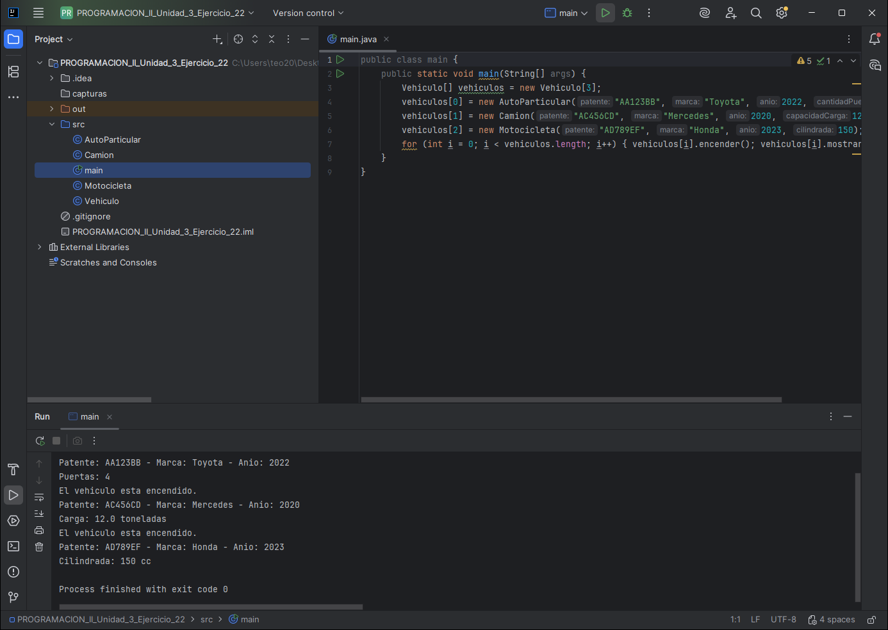

# PROGRAMACIÓN II — Unidad 3, Ejercicio 22: Jerarquía de Vehículos de Transporte

Trabajo práctico de Programación II. Este repositorio contiene la resolución en Java del ejercicio 22 de la Unidad 3.

## Consigna

#### Contexto

En un sistema de gestión de flotas, los vehículos poseen propiedades comunes como patente, marca y año de fabricación. Sin embargo, los automóviles particulares, los camiones de carga y las motocicletas poseen características y normativas de circulación completamente diferenciadas que justifican una estructura jerárquica.

#### Consigna

Construir una jerarquía de clases orientada a objetos en Java que modele un vehículo genérico y sus respectivas especializaciones de transporte terrestre.

#### Desarrollo requerido

- Crear la clase base Vehiculo con atributos comunes y métodos de encendido o estado general.
- Desarrollar clases hijas como AutoParticular, Camion y Motocicleta que extiendan de Vehiculo añadiendo atributos propios (como capacidad de carga en toneladas o cilindrada).
- Implementar el uso de la palabra clave super en los constructores de las subclases para inicializar los atributos heredados.
- En el método main, crear instancias de los distintos tipos de vehículos, invocar sus métodos particulares y mostrar los detalles por consola.

## Estructura del repositorio

```
PROGRAMACION_II_Unidad_3_Ejercicio_22/
├── README.md
├── capturas/
│   └── consola.png
└── src/
    ├── AutoParticular.java
    ├── Camion.java
    ├── main.java   # clase con el método main
    ├── Motocicleta.java
    └── Vehiculo.java
```

## Funcionamiento y lógica

El ejercicio aplica **polimorfismo con un arreglo de la superclase**: vehículos de distintos tipos se guardan juntos y se recorren con un mismo ciclo.

### `Vehiculo` (clase base)

Tiene `patente`, `marca` y `anio` (`protected`), el método `encender()` (común para todos) y `mostrarDatos()`.

### `AutoParticular`, `Camion` y `Motocicleta`

Heredan de `Vehiculo`, agregan su propio atributo (puertas, carga en toneladas o cilindrada) y sobrescriben `mostrarDatos()` (`@Override`). Cada uno llama primero a `super.mostrarDatos()` y después agrega su dato.

### `main`

Crea un arreglo `Vehiculo[]` de 3 posiciones y guarda en él un auto **Toyota**, un camión **Mercedes** y una moto **Honda**. Lo recorre con un `for` y, en cada posición, llama a `encender()` y `mostrarDatos()`. El código del ciclo es el mismo para todos, pero cada objeto muestra sus datos según su tipo real.

## Ejecución

Captura de la consola de IntelliJ IDEA ejecutando el programa:



Salida obtenida:

```
El vehiculo esta encendido.
Patente: AA123BB - Marca: Toyota - Anio: 2022
Puertas: 4
El vehiculo esta encendido.
Patente: AC456CD - Marca: Mercedes - Anio: 2020
Carga: 12.0 toneladas
El vehiculo esta encendido.
Patente: AD789EF - Marca: Honda - Anio: 2023
Cilindrada: 150 cc
```
